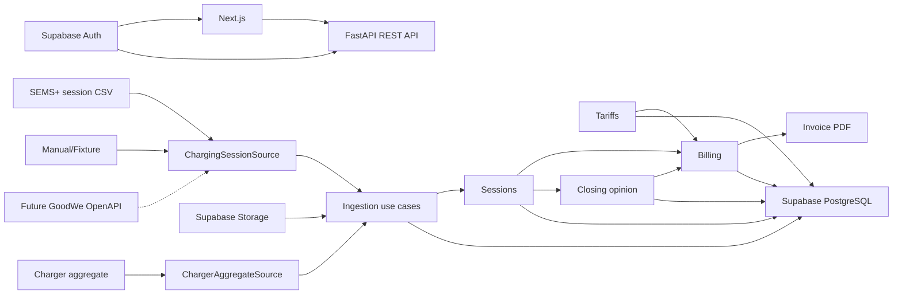

# EV ChargeOps - Technical Specification

**Version:** 0.2

**Status:** approved for implementation

**Date:** 30 August 2026

**PRD:** [../product/prd.md](../product/prd.md)

**Decisions:** [../decisions](../decisions)

## 0. What changed in version 0.2

Alignment with the invoice-first cut of [PRD 0.4](../product/prd.md). The technical changes
are:

- The `payments` module and the `PaymentGateway` port leave the increment.
- The `tariffs` and `billing` modules come in, and the `insights` module delivers only the
  closing opinion in this increment.
- A second ingestion source comes in for the charger's energy aggregate, which does not
  produce billable sessions.
- PDF rendering comes in as a port.
- The resident context (impersonation) comes into the authorization model.
- Section 7 now documents the contract for deriving sessions from the GoodWe OpenAPI, which
  reading the official documentation made it possible to specify.

## 1. Technical goal

Build a modular web application that turns charging records from replaceable sources into
canonical sessions, a versioned allocation and auditable invoices. The first source is a CSV
file compatible with the history observed in SEMS+; future APIs and protocols implement the
same contracts.

## 2. Stack

- **Frontend:** Next.js with App Router, React, TypeScript and Tailwind CSS.
- **Backend:** Python, FastAPI, Pydantic and REST.
- **Contract:** OpenAPI generated by the backend and a TypeScript client generated or
  validated in the monorepo.
- **Persistence:** PostgreSQL managed by Supabase, accessed by FastAPI with SQLAlchemy;
  migrations with Alembic. SQLite for the local demo.
- **Identity:** Supabase Auth; JWT validated by FastAPI.
- **Files:** Supabase Storage for import originals, accessed through the backend.
- **Workspace:** mixed monorepo; pnpm for frontend/client and an isolated Python project for
  the API.
- **Data and AI:** pandas and scikit-learn, with reproducible, versioned runs.
- **Tests:** pytest in the backend and Playwright for the application's critical flows.

## 3. High-level architecture



Next.js does not access operational tables directly. FastAPI concentrates authorization,
rules, audit, integrations and the analytical modules.

The dashboard does not rebuild sessions from raw import records. It queries the canonical
read model; audited assignments therefore show up immediately in the per-unit totals, and no
`Card ID` or charger serial is promoted to billing identity.

The charger aggregate comes in through its own port and lands in its own table. It never
feeds `ChargingSession`.

## 4. Monorepo structure

```text
ev-charging-billing/
├── apps/
│   ├── web/
│   │   ├── src/
│   │   └── e2e/
│   └── api/
│       ├── app/
│       │   ├── modules/
│       │   └── shared/
│       ├── alembic/
│       ├── tests/
│       └── pyproject.toml
├── packages/
│   └── api-client/
├── docs/
└── data/
    ├── charger-export/     ← synthetic exports in the vendor's format
    └── reference-example/  ← simulated worked example for the golden test
```

## 5. Backend organization

Each module follows a domain-oriented internal structure:

```text
modules/billing/
├── domain/
├── application/
├── infrastructure/
└── presentation/
```

- **domain:** entities, value objects and pure rules.
- **application:** use cases and ports.
- **infrastructure:** SQLAlchemy, Supabase, external adapters and analytical implementations.
- **presentation:** FastAPI routers, Pydantic schemas and HTTP mapping.

Modules in this increment: `identity`, `organizations`, `ingestion`, `sessions`, `tariffs`,
`billing`, `insights` and `audit`.

Inside `insights`, only `closing_opinion` is implemented now. `forecasting` and
`segmentation` remain in the plan with their contracts defined and no implementation.

The `payments` module leaves the increment. Its contract stays recorded in Section 6 as a
future extension.

## 6. Main ports

```python
class ChargingSessionSource(Protocol):
    kind: SourceKind

    async def read(self, input: SessionSourceInput) -> list[SourceRecord]: ...

    def normalize(self, record: SourceRecord) -> SessionCandidate: ...


class ChargerAggregateSource(Protocol):
    """Aggregate energy reported by the equipment. Never produces a SessionCandidate."""

    kind: SourceKind

    async def read(self, input: AggregateSourceInput) -> list[AggregateRecord]: ...

    def normalize(self, record: AggregateRecord) -> ChargerEnergyReading: ...


class TariffProvider(Protocol):
    async def get_applicable_tariff(self, query: TariffQuery) -> TariffSnapshot: ...


class ClosingOpinionAnalyzer(Protocol):
    def analyze(self, dataset: PeriodDataset) -> ClosingOpinion: ...


class InvoiceRenderer(Protocol):
    def render_pdf(self, invoice: IssuedInvoice) -> RenderedDocument: ...
```

Adapters in this increment: `SemsCsvSource`, `ManualSessionSource`, `SemsAggregateCsvSource`,
`VersionedTariffProvider`, `RuleBasedClosingOpinionAnalyzer` and `PdfInvoiceRenderer`.

Contracts preserved for P1, with no implementation: `ConsumptionForecaster`, `UsageSegmenter`
and `PaymentGateway`.

Ports receive canonical datasets, never DataFrames or vendor-specific payloads. pandas and
scikit-learn remain infrastructure details.

## 7. Vendor data sources

### 7.1 Current situation

The EV Charger API was not available for this project. Session ingestion happens through
structured file import, with provenance recorded per batch.

### 7.2 What the GoodWe OpenAPI exposes

The official documentation (`openapi.goodwe.com`) defines `deviceType = 5` as EV Charger and
offers no endpoint for session history. The surface available is station query, device list,
attributes, real-time and historical telemetry, statistics, alarms and remote dispatch.

The EV Charger attributes are only `model` and `ratedPower`. The only statistic is
`evChargercharge`, aggregate energy in kWh.

**There is no identity field anywhere in the specification.** No card, RFID, user or owner.
That is the structural gap EV ChargeOps fills: assigning consumption to a unit cannot be
derived from the vendor and requires an auditable human decision.

### 7.3 Contract for deriving sessions

EV Charger telemetry supports historical queries and contains the fields needed to derive
sessions deterministically:

| Field | Use in the derivation |
|---|---|
| `vehConnectStatus` | State machine: `0` disconnected, `1` connected without charging, `2` charging |
| `currentChargeE` | Energy of the current session, in kWh |
| `currentChargeTime` | Duration of the current session, in seconds |
| `activePower` | Instantaneous charging power, in kW |
| `evChargerCharge` | Accumulated energy of the equipment |
| `refreshTime` | Instant of the sample, UTC in milliseconds |

Rule: a session starts on the transition to `vehConnectStatus = 2` and ends on leaving that
state. At the end, `currentChargeE` fixes the energy and `currentChargeTime` fixes the
duration. `activePower` gives the session's internal curve.

Once credentials exist, the `GoodWeApiSource` adapter implements `ChargingSessionSource` by
applying this rule, without changing the domain. CSV is today's adapter because the
credential is missing, not because the data is.

## 8. Canonical session model

| Field | Rule |
|---|---|
| `id` | Internal UUID |
| `organizationId` | Required for isolation |
| `siteId` | Site of the infrastructure |
| `chargerId` | Internal charger resolved by serial |
| `source` | Normalized source |
| `externalId` | External identifier when one exists |
| `deduplicationKey` | Hash of source, charger, start, end and energy |
| `startedAt`, `endedAt` | UTC; end after start |
| `energyKwh` | Positive decimal |
| `averagePowerKw` | Derived from energy and duration |
| `chargePort` | Optional |
| `cardIdRaw` | Optional and untrusted by default |
| `unitId` | Optional until assignment |
| `identityConfidence` | `confirmed`, `assigned` or `unknown` |
| `importBatchId` | Batch that produced the session |
| `rawRecordId` | Auditable raw record |
| `status` | `pending_review`, `ready`, `flagged`, `billed` or `discarded` |

The raw field labeled `Card ID` is not used as confirmed identity while it repeats the
charger's serial.

## 9. Persistent entities

- `Organization`, `Site`, `Charger`, `Unit`, `Profile`, `Membership`.
- `ImportBatch`, `RawImportRecord`, `ChargingSession`, `SessionAssignment`.
- `ChargerEnergyReading` — the equipment's aggregate per period, with provenance. Not
  billable.
- `TariffSnapshot`, `BillingPolicy`, `BillingPeriod`.
- `Invoice`, `InvoiceItem`, `InvoiceDocument`.
- `AnomalyFlag`, `ClosingOpinion`, `InsightRun`, `AuditEvent`.

Monetary values use integer cents. Energy and power use `numeric` with explicit precision.
Instants use `timestamptz`.

`BillingPeriod` records state (`open`, `closing`, `closed`), the actor and instant of the
approval, and the immutable snapshot of tariff and policy applied at closing.

`Invoice` references the snapshot, not the tariff in effect. A tariff changed later does not
change any issued invoice.

## 10. Idempotency and states

### Import

- `ImportBatch.checksum` prevents accidental repetition of the same file.
- `ChargingSession.deduplicationKey` has a unique index per organization.
- Invalid records stay linked to the batch without creating a session.
- The aggregate uses a unique key per organization, charger, period type and period value.

### Closing

- The closing is transactional: it creates the snapshot, issues invoices and marks sessions
  as `billed` in a single operation.
- Re-running the closing of an already closed period is rejected with a conflict.
- A billed session does not move to another invoice through a silent edit.
- Corrections produce a reversal or a new audited version, outside the scope of this
  increment.

### Calculation

- The allocation is a pure function of `(eligible sessions, tariff snapshot, policy)`.
- The same input always produces the same output, in integer cents.
- Rounding is defined once in the domain.

## 11. REST API

```text
POST   /v1/import-batches/preview
POST   /v1/import-batches
GET    /v1/import-batches/:id
POST   /v1/charger-readings/import
GET    /v1/charger-readings
GET    /v1/sessions
GET    /v1/sessions/:id
PUT    /v1/sessions/:id/assignment
GET    /v1/assignment-units
GET    /v1/tariffs
POST   /v1/tariffs
GET    /v1/billing-periods
POST   /v1/billing-periods
GET    /v1/billing-periods/:id
GET    /v1/billing-periods/:id/readiness
POST   /v1/billing-periods/:id/close
GET    /v1/invoices
GET    /v1/invoices/:id
GET    /v1/invoices/:id/document
POST   /v1/insight-runs/closing-opinion
GET    /v1/insight-runs/:id
GET    /v1/dashboard/manager
POST   /v1/resident-context
DELETE /v1/resident-context
```

List endpoints accept pagination, period and organizational scope. No identifier received
from the client replaces the scope derived from the token.

`GET /v1/billing-periods/:id/readiness` returns assignment coverage, blocking pending items,
internal reconciliation and reconciliation against the charger aggregate.

The list above is the contract as specified. The contract as built is the generated OpenAPI
document in `packages/api-client/openapi.json`.

## 12. Authentication and authorization

1. Next.js authenticates through Supabase Auth.
2. Requests to the API carry a JWT in the `Authorization` header.
3. FastAPI validates signature, expiry and claims.
4. An authorization dependency resolves `profile`, `membership`, `organizationId` and role.
5. Use cases receive the already validated scope.
6. Repositories apply `organizationId` to every operational query.

### Resident context

`POST /v1/resident-context` lets the manager assume a context restricted to one unit.

- The resulting context carries the `resident` role and a `unitId`, and is resolved by the
  **same** authorization dependency used by a real resident.
- Repositories apply the unit filter on top of the organization filter.
- Every write is rejected while the context is active.
- Entering the context produces an `AuditEvent` with actor, unit and instant.
- The context is short-lived and is ended explicitly.

This is the only entry point for the `resident` role in this increment. Building a dedicated
resident login later changes nothing except adding another way to obtain the same context.

Supabase RLS protects any surface exposed by Supabase itself. The application does not hand
`service_role` to the browser.

## 13. Provenance and audit

Each session keeps its raw record and source. Assignment, discard, closing, issuing and
entering a resident context produce an `AuditEvent` with actor, instant, organization, entity
and sanitized metadata.

The interface distinguishes:

- `real`: time and energy obtained from SEMS+.
- `assigned`: unit linked by a recorded human decision.
- `simulated`: data created to cover a scenario with no real observation.
- `derived`: value computed from other fields.
- `external`: tariff or state obtained from a third-party service.

Real and demonstration data are never added together without the interface showing the
composition.

## 14. Errors

The API uses a stable envelope:

```json
{
  "error": {
    "code": "SESSION_DUPLICATE",
    "message": "The session has already been imported.",
    "correlationId": "uuid",
    "details": []
  }
}
```

Categories: validation (400/422), authentication (401), authorization (403),
conflict/idempotency (409), external dependency (502/503) and internal failure (500).
Messages to the client do not include secrets or sensitive payloads.

Closing a period with unresolved blockers returns `409` with the list of blockers.

## 15. Tariff, allocation and closing

### Versioned tariff

`TariffSnapshot` stores time bands with a value in cents per kWh, validity, source and
capture date. A band is resolved for each session from the observed time.

### Allocation policy

`BillingPolicy` stores the infrastructure fee per active unit and the loss percentage, with
its own version.

### Calculation

```text
invoice(unit, period) = individual_energy + infra_fee + loss_share
```

Implemented as a pure function over integer cents, with a single rounding defined in the
domain. Validated against the worked example in `data/reference-example/invoices.csv`.

### Reconciliation

The closing computes and shows two differences:

- **Internal:** eligible energy minus billed energy. Expected to be `0.00 kWh`.
- **External:** billed energy minus the charger aggregate for the period. When different
  from zero, it is presented as a warning with the value, never absorbed into the invoice.

## 16. Closing opinion

Combines deterministic validations with statistical analysis of the relation between energy,
duration and derived power, compared with the equipment's rated power.

It identifies at least invalid times, non-positive energy, incompatible average power,
duplicates and outliers against the available history.

Each finding includes a rule or algorithm, severity, evidence, explanation and confidence.
The consolidated opinion presents a conclusion, severity, confidence, evidence and a
recommendation. Critical findings block the closing until a decision is recorded.

An insufficient sample produces an explicitly inconclusive result.

Each `InsightRun` records type, algorithm version, parameters, seed when applicable, dataset
checksum, instant, metrics and provenance. The modules do not access the database directly:
use cases build canonical datasets and persist the results returned.

The opinion acts **before** the invoice. It does not recompute financial values.

## 17. Observability

- JSON logs with `correlationId`, module, organization, operation and result.
- Metrics for batch, duration, rejection, duplication, insight runs and closings.
- Audit log kept separate from technical logs.
- Raw payloads, tokens and emails do not go into logs.

## 18. Test strategy

- **Unit:** entities, deduplication, allocation, states, rounding and anomaly rules.
- **Golden:** the allocation engine is checked against the invoices in
  `data/reference-example/invoices.csv`, including an interrupted session, a unit with no
  consumption and two users in the same unit.
- **Adapter contract:** every source produces the same `SessionCandidate` for equivalent
  fixtures.
- **Reconciliation:** closing over a known fixture closes at `0.00 kWh` internally and
  reports the expected external difference.
- **Immutability:** changing the tariff after issuing does not change any issued invoice.
- **Integration:** SQLAlchemy/PostgreSQL, authentication, isolation and endpoints.
- **Authorization:** cross-organization access, and a resident context that cannot reach
  another unit or perform a write.
- **E2E:** import, assign, review the opinion, approve the closing, issue the invoice,
  download the PDF and view as a resident.
- **Security:** invalid files and absence of secrets.

## 19. Deployment

- Frontend and backend are independent artifacts of the same monorepo.
- Supabase provides Postgres, Auth and Storage.
- Alembic migrations run in a controlled step of the deploy.
- The `local`, `preview` and `demo` environments use isolated projects or schemas.

## 20. Evolution path

1. SEMS+ CSV and the labeled demonstration scenario.
2. The `GoodWeApiSource` adapter once credentials exist, applying the rule in Section 7.3.
3. Forecasting and segmentation, over accumulated history.
4. Payment, once there is a decision to charge outside the building's monthly fee.
5. Formal correction and reopening of closed periods.
6. Extracting the AI into an independent service only when scale, ownership, runtime or
   deployment justify it.

The session, allocation and audit domain stays stable through every stage.
